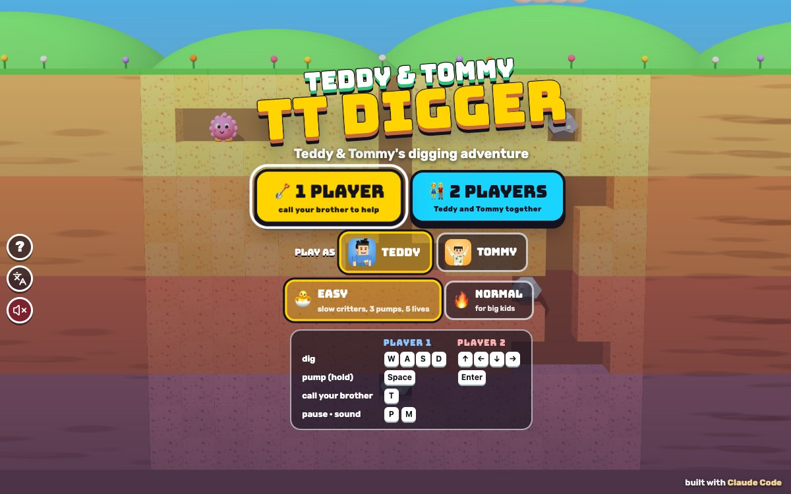

# TT Digger

[](https://adong.github.io/digger-tt/)

Press **?** any time (or tap the round **?** button on the left edge) to see the keys. The game waits while you look.
Tap the language button under it (the A文 icon) to switch between English and 中文; the dashboard and every game remember the choice.

**中文：** 挖地小英雄：戴上安全帽挖地道，用打气筒把圆滚滚的小怪和爱打喷嚏的小龙吹成气球飘走，或者挖空石头下面的泥土让石头掉下来把它们压成薄饼。单人（随时叫兄弟来帮忙）或 Teddy 和 Tommy 一起玩。

An arcade digging game starring Teddy and Tommy, built with Claude Code from plain JavaScript and Three.js on the shared Claude Games kit.
You dig tunnels through four layers of coloured earth in a chunky toy garden. Round puffball critters and little sneezy dragons wander the tunnels. Hold the air pump on one and he puffs up, bigger and bigger, until he floats away like a balloon. Or dig under a rock so it wobbles and falls, and flattens them like pancakes.
Nobody gets hurt: a critter that catches you tickles you, a dragon's sneeze is a cloud of sparkles, and pumped or flattened critters just float off waving goodbye.
There are no image, model or audio files: the boys are the kit's blocky characters (in hard hats), the critters are built from spheres, every texture is painted on a canvas, and every sound is synthesised.
It's our own game: our own name, characters, art and sounds.

The name lives in one place, `DG.TITLE` in `js/title.js` (and `DG.ZH`, 挖地小英雄, for the 中文 logo). Change it there (and in the `<title>` of `index.html`) and the logo, menus and the ? panel follow.

## Play

- **Double-click `index.html`.** It works offline because Three.js and the kit are copied into `kit/`. Without internet the title font falls back to Arial Black.
- **Send one file:** `dist/digger-tt.html` is the whole game in one file, about 830 KB. AirDrop or email it, then open it in a browser.
- Rebuild that file after any edit: `python3 kit/tools/bundle.py . --name digger-tt`

Pick **🪏 1 PLAYER** or **👫 2 PLAYERS**, who to play as (1 player), and a difficulty, on the title screen.

| Difficulty | |
|---|---|
| 🐣 **EASY** (the default), for Tommy (5) | 5 lives. Slow critters that wander more than they chase and never ghost through the earth. 3 pumps float a critter away, and he shrinks back slowly. Dragons wind up their sneeze for longer and it only reaches 2 cells. A falling rock just goes BOINK! on your hard hat. |
| 🔥 **NORMAL**, for Teddy (8) | 3 lives. Quicker critters that chase you and can slowly ghost through the earth. 4 pumps, and a critter shrinks back faster. Sneezes reach 3 cells. Don't stand under a falling rock! |

## Rules

- **Digging:** walk and you dig. Every new cell of earth is 10 points. You can dig anywhere except through a rock. The tunnel from the grass down to the start is dug already.
- **The earth** has four coloured layers (sand, orange clay, red clay, purple deep earth). **Deeper scores more:** a critter popped in the 1st, 2nd, 3rd or 4th layer is 200, 300, 400 or 500.
- **The air pump** (hold **Space**): the hose shoots along the tunnel in front of you (about 3 cells, never through earth) and hooks the first critter it meets. Keep holding and you pump him: PUFF! PUFF PUFF! After 3 pumps (EASY) or 4 (NORMAL) he turns into a balloon and floats away. Let go too early and he shrinks back one puff at a time and walks off again. While you hold the pump on a critter you stand still; let go and you can walk. A puffed-up critter can't tickle you.
- **The critters** each start in their own little tunnel:
  - 🎈 **Puffballs**, round and fluffy in pink, peach, sky blue, lilac or mint, with big eyes that follow you.
  - 🐉 **Sneezy dragons**, little green dragons with purple wings. When you're in their row and close, they go "AH... AH..." and then ACHOO!: a cloud of rainbow sparkles along the row (it goes through earth too). Pump them while they wind up and the sneeze is off.
  - **Ghosting (NORMAL):** every so often a critter turns see-through and floats slowly through the earth toward a tunnel near you, then turns solid again. A ghost can't tickle you and can't be pumped.
- **Rocks:** dig the cell under a rock and it waits until you walk out from under it, wobbles, then falls straight down until it meets earth. Critters under it are flattened like pancakes, peel off the floor and float away: 1,000 for one, 2,500 for two, 4,000 for three. A rock leaves a hole where it was and crumbles where it lands.
- **The veggie:** after two rocks have fallen a veggie pops up at the start (🥕 🍅 🥒 🌽 🍆 🫑 🥦 🍄, a different one each level) for a few seconds: 400 to 5,000 points.
- **Getting caught:** a critter that touches you tickles you ("TICKLE TICKLE!"), a sneeze sparkles you, and on NORMAL a rock can squish you. You giggle, lose a ❤️, and pop back at the start, blinking (safe) for 2.6 s. The critter that caught you goes back to its tunnel.
- **A level ends when every critter is gone** (popped or flattened). The boy who got the last one does his signature move: Teddy shadow-boxes and sinks a 🏀 jump shot, Tommy does his Y pose ✌️. Confetti, then **NEXT LEVEL ▶** with your score and your HI-SCORE (kept for each difficulty). Each level has more critters (EASY up to 6, NORMAL up to 8), 3 to 5 rocks, a little more speed, and a new sky: sunny meadow, blueberry hill, sunset farm, starry garden.
- **Out of hearts:** "OOPS!" and **PLAY AGAIN** tries the same level with full hearts and a fresh score (the HI-SCORE stays).
- **2 players:** Teddy (player 1) and Tommy (player 2) dig together and share the hearts; the score is shared and each boy's own points show by his face. A brother who runs out of hearts sits out while the other carries on.

The levels are made from a seed (`js/levels.js`), so level 3 is always the same level 3: each critter has its own 3-cell tunnel well away from the start, rocks never touch each other (so nothing can be walled in), and some rocks sit just above a critter's tunnel with one cell of earth between.

## Controls

| | Player 1 | Player 2 | Touch |
|---|---|---|---|
| dig | W A S D | ↑ ← ↓ → | hold the round pad |
| pump (hold) | Space | Enter | hold the green PUMP button |
| call your brother | T | | the big button with his face |

- In 1 player both key sets move you and both Space and Enter pump.
- You walk while you hold a direction and stop when you let go. Turning a corner, he walks to the nearest cell centre first, then turns. A tap shorter than a frame still counts.
- **P** or Esc pauses and **M** turns the sound on or off. The ❚❚ and 🔊 buttons at the top do the same. On the menus, the round speaker button under the A文 button (and the speaker in the ? panel) mutes too, and they all stay in step.
- **Menus:** ← → pick 1 or 2 players, ↑ ↓ (or W S) switch Easy / Normal, A D switch Teddy / Tommy, Enter or Space goes, 1 and 2 jump straight in. On the results, Enter goes on and Esc goes to the menu.
- **Touch:** the round pad sits bottom left (with two players, each brother has a pad in his corner and his PUMP button just above it). The ? and A文 buttons stay on the left edge, clear of the board and the pads; on a tall phone they sit just under the board.

## Companion

Your companion is the other brother: **Tommy** comes for Teddy, and **Teddy** comes when Tommy is the one playing (`Kit.roster.buddyFor`).

- **Calling him:** press **T** or tap the big button with his face, any time and as often as you like. He pops in right beside you, at his smaller buddy size, in a puff of confetti ("TOMMY IS HERE!").
- **His signature move:** Tommy does his Y pose with peace fingers; Teddy shadow-boxes, jab and straight.
- **A treat:** he tosses you a 🍦 💧 🧃 🍪 🍉 or 🍌, which floats over your head for a moment ("🧃 JUICE BOX FROM TOMMY!").
- **The helper:** "TOMMY SAYS: PUMP PUMP POP!" He zooms through the earth to the nearest critter (a ghost he picks turns solid), holds it still and pumps it until it floats away. The points are yours.
- **Call him again** while he's there ("TOMMY SAYS: ONE MORE!") and he pumps one more critter after this one. So Tommy can protect you as long as you keep calling him.
- **Bye:** Tommy waves his Y again, Teddy sinks a 🏀 jump shot, and he's gone in a puff.
- **2 players:** both brothers are already playing, so **T** (or tapping a face at the top) is a fun ✋ HIGH FIVE!

## How it works, and how it's tested

- `js/sim.js` has the rules and no Three.js: the earth grid, the diggers and their hoses, the critters, rocks, the veggie and the companion. It reports what happened as events, which `js/game.js` turns into effects, sounds and toasts.
- `js/bot.js` is the autopilot (the demo behind the title screen, the soak, and the "keyboard kid" in the play check). It digs toward the nearest critter and holds the pump, and steps aside from a sneeze or a wobbling rock.
- **The headless check** (`js/checks.js`), in Node with no npm, or `game.check()` in the browser console:

```bash
node tools/check.js
```

```bash
node tools/check.js --soak=6
```

  - **dig:** walking digs cells one by one and scores 10 each, a rock stops you, earth nobody walked through stays.
  - **pumps:** a critter floats away on exactly pump 3 (EASY) or 4 (NORMAL); pumped to one less and let go, he shrinks back one puff at a time to 0 and walks again.
  - **free:** while you hold the pump on a critter you stay put; let go and you walk every way again.
  - **rock:** a rock stays put while other cells around it are dug, waits while you stand right under it, wobbles for the full wobble time, then falls and flattens the critter below; the veggie comes after the 2nd rock.
  - **end:** with the companion pumping three critters (nearest first), the level doesn't end until the last one is gone, and ends then.
  - **layout:** levels 1-12 on EASY and NORMAL: every cell but the rocks can be reached from the start, no rock starts loose, no critter starts next to you, and each level has its full number of critters.
  - **The variant that must fail:** `game.prove()` (and the second part of `node tools/check.js`) runs every check again with one rule broken at a time: no digging, mirrored arrows, an extra pump needed, no popping, no shrinking back, a pump that never lets you go, rocks that fall without being dug under, rocks that don't wobble, rocks that don't wait for you, a level that never ends, a level that ends early, a walled-in cell. At the last run all 12 were caught, and the real rules passed every check.
  - **Soak:** the autopilot cleared levels 1-6 on EASY and NORMAL, 1 and 2 players: 24 of 24.
- **The play check with real keys** (`js/playcheck.js`), `game.playCheck()` in the page: everything goes in through `keydown`/`keyup` events on `window` and pointer events on the pad and the PUMP button, and time runs through `game.step`.
  - **direction:** on levels 1-6, EASY and NORMAL, 1 and 2 players, with each player's own keys (both sets in 1 player): → moves the boy right on the screen, ← left, ↑ up, ↓ down, measured where he is drawn (projected through the camera). 192 presses.
  - **touch:** the pad moves him the way the finger points (1 and 2 players), and the PUMP button sends out the hose.
  - **pump:** holding Space pops a critter, and letting go early shrinks him back to 0.
  - **stuck:** after pumping, after being tickled, after pausing with a key held down (it doesn't keep walking), after the window loses focus with a key down: every open way still moves him. Then a "keyboard kid" (the autopilot's choices pressed as real keys, plus random extra key bumps) plays levels 1-3 on EASY and NORMAL for up to 45 s each; he never left the board or ended up in a rock, and could still walk every open way at the end (it also cleared the level in 4 or 5 of the 6 runs; that number varies from run to run).
  - `game.playCheck.prove()` runs it with the arrows mirrored and with a pump that never lets go: the first fails the direction and touch checks (→ moved him 52 px left), the second fails the stuck check. Both failed as they should, and the real game passed all four parts.
- Tested muted (`localStorage['claudeGames.muted'] = '1'`); sound was checked in code: all 24 of the game's sounds run without errors, and M and the 🔊 button flip the one sound switch.
- 中文: with `Kit.lang.set('zh')` every screen (title, play, the companion's visit, pause, the ? panel, a tickle, level clear, results, game over, 2 players and the high five) gave `Kit.lang.untranslated()` = [], and all 67 toast and comic-word templates (every name, treat and veggie) translate. In English the only Chinese on the page is the kit's language button tooltip.
- Layouts checked at 1200x750, phone portrait 390x844, phone sideways 740x360, iPad 1024x768 and 820x1180, 1 and 2 players with the touch pads: the board, the pads and the kit's ? / A文 buttons don't overlap.
- Console hooks (`window.game`) for testing in a browser whose animation is throttled:

```js
game.start({ two: false, diff: 'easy', level: 1, hero: 'teddy', skipReady: true })  // jump into a level
game.step(1)          // advance 1 s (keys included) and draw; game.step(1, { draw: false }) is faster
game.hold(true)       // stop the live loop so only step() moves time
game.autoPause(false) // don't pause when the tab or pane is hidden
game.callBuddy(0)     // call the companion (2 players: a high five)
game.toScreen(x, y)   // where a grid cell is drawn on the screen
game.info()           // screen, level, score, lives, players
```

## Files

```
index.html        page, HUD, menus, touch controls (CSS inline), the tab and home-screen icon (🪏 on earth orange #f6a35c)
js/title.js       the name, in one place
js/config.js      difficulty and tuning numbers
js/levels.js      the seeded level maker
js/sim.js         the rules (no Three.js)
js/bot.js         the autopilot
js/checks.js      the headless check, prove and soak
js/input.js       keys and touch to { dir, pump } for each player
js/art.js         earth, sky, rocks, puffballs, dragons, helmets, hoses, comic words, particles
js/game.js        scene, camera fit, syncing, effects, HUD, menus, companion, the loop, window.game
js/playcheck.js   the real-key play check
js/sfx.js         synth sounds through Kit.sound
js/keys.js        the ? panel (Kit.help)
js/zh.js          the 中文 dictionary (Kit.lang)
tools/check.js    runs the headless check in Node
tools/shoot.js    screenshots with headless Chrome (docs/screenshot.jpg: node tools/shoot.js tools/shots.json docs 1200 750)
kit/              the shared Claude Games kit (synced with python3 ../kit/tools/sync.py .; edit it in ~/claude-games/kit)
dist/             the single-file build
```

## Not verified

- Sound by ear: everything was tested muted, and sound was only checked in code.
- Real fingers on an iPad or phone, iOS Safari, and two kids on one iPad (touch was tested with synthetic pointer events in headless Chrome).
- A real Finder double-click (the `dist` page and `index.html` were opened from `file://` in headless Chrome).
- Whether the difficulty is right for real kids: the autopilot clears every level tried, losing 0-2 lives a level on EASY and 1-2 on NORMAL.
- The iPad home-screen icon.
- Frame rate on an older iPad.
